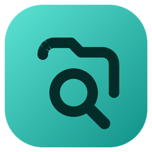

<p align="center"></p>

# DriveSync

A real-time desktop search engine for Windows. DriveSync keeps a live index of the folders you choose
(or every drive), finds files by name as you type, and summarizes the selected file on demand, all on
your PC. The interface follows the design in `design/drivesync.html` and `design/DriveSync-UI-Design.pdf`.

## 1. Install once

1. **.NET 8 SDK**: "SDK 8.0 x64 for Windows" from <https://dotnet.microsoft.com/download/dotnet/8.0>.
   Check with `dotnet --version` in a new Command Prompt.
2. **Visual Studio Code** with the **C# Dev Kit** extension (or Visual Studio 2022).

## 2. Build and run

From the `DriveSync` folder (the one with `DriveSync.sln`):

```
dotnet run --project src/DriveSync.App
```

The first build downloads its NuGet packages, so it needs internet once. Press **F5** in VS Code to run with
the debugger. `dotnet publish src/DriveSync.App -c Release -r win-x64 --self-contained` makes a standalone app.

**First start** opens the four-step setup: Welcome → Choose folders (any folders, or All drives) → Build index →
Ready. After that DriveSync loads its saved index at start-up instead of scanning again, and keeps it current
with file-system watchers and a scheduled refresh.

## 3. Using it

| Where | What you can do |
|---|---|
| **Home** (Alt 1) | Quick search, recent searches, index stats with the next-refresh countdown, recently changed files, the Select → Index → Parse → Search pipeline, watched folders |
| **Search** (Alt 2, Ctrl K or /) | Results as you type with the lookup time; Type, Folder (All drives, an indexed folder or Browse…), Modified and Sort filters; operators `ext:pdf`, `in:semester`, `type:code`; close matches when nothing matches exactly |
| **Preview** | Summary (key sentences, keywords, word count, read time, parse time), Outline (headings, slides, sheets, or code symbols) and Details (metadata and index tokens). Explains locked files (and which app holds them), disconnected drives, images, unsupported types and the size limit |
| **Indexed folders** (Alt 3) | Add, pause/resume, rescan and remove folders (with Undo); disconnected-drive banner; exclusions (`bin`, `*.tmp`, full paths) applied at once |
| **Live activity** (Alt 4) | Every add, change, rename and delete as it happens, index health, a 24-hour chart |
| **Benchmarks** (Alt 5) | Indexed lookup against a real directory walk at 2k–100k of your files, plus Windows Search when its index answers |
| **Settings** (Alt 6, Ctrl ,) | Start with Windows, keep running in the tray, global shortcut, refresh interval, size limit, hidden files, battery saver, summary length, accent colour, transparency, reduce motion, compact rows, rebuild/clear index |

Right-click a result (or Shift F10) for Open, Show in folder, Copy path, Copy name, Summarize and Exclude this
folder. Enter opens, Ctrl Shift C copies the path, ? lists every shortcut. Closing the window keeps DriveSync
running in the tray; the tray icon opens a status flyout.

## 4. How it works

```
DriveSync.sln
├── src/DriveSync.Core               the engine (no UI)
│   ├── Indexing/IndexEngine.cs       in-memory index: depth-first folder ranges, token maps, bitset queries, top-K
│   ├── Indexing/Tokenizer.cs         names → tokens (camelCase, letters/digits, separators)
│   ├── Indexing/FileScanner.cs       parallel folder walk (one worker per core, shared stack)
│   ├── Indexing/IndexService.cs      folders, jobs and stages, watchers, scheduled refresh, drives, activity log
│   ├── Storage/IndexStore.cs         SQLite: index snapshot + change journal, settings, history, events
│   ├── Parsing/                      DOCX/PPTX/XLSX (OpenXml), PDF (PdfPig), ODF, HTML, RTF, Markdown, CSV, code;
│   │                                 extractive summarizer; Restart Manager lock detection; summary cache
│   └── Benchmarking/BenchmarkRunner.cs
└── src/DriveSync.App                the Windows app (WPF)
    ├── Themes/                       Tokens.xaml (design tokens), Icons.xaml (generated), Controls.xaml (component states)
    ├── Shell/                        Mica, tray, global hotkey, Start with Windows, toasts, dialogs, motion
    ├── Pages/                        Home, Search + PreviewPane, Indexed folders, Live activity, Benchmarks, Settings
    └── Dialogs/                      Add folder, confirmations, keyboard shortcuts, first-run setup
```

**Why searching is fast.** Folders are numbered depth-first and files are stored folder by folder, so "this folder
and everything below it" is one contiguous range. Every name and folder name is split into tokens kept in sorted
arrays with posting lists. A query looks up each word's prefix range, combines the matches with bitset ANDs, and
keeps only the best results with a heap. Nothing touches the disk while you search. Measured numbers are in
`DESIGN_PLAN.md`.

**Staying current.** One FileSystemWatcher per indexed folder applies changes within a second and logs them
to Live activity. If Windows drops notifications (buffer overflow), only that folder is rescanned. A scheduled
refresh (every 15 minutes by default) reconciles everything. Changes are written to SQLite in batches every
few seconds; full scans save a compact snapshot.

**Summaries.** Each word that isn't a common word is counted; each sentence is scored by its words' counts
divided by its length^0.55, boosted when it opens a section or the document. The best sentences are shown in
reading order. Code files get a structural overview (doc comment, types, members) instead.

## 5. Releasing (installer and auto-updates)

DriveSync is packaged with [Velopack](https://velopack.io) and published on this repo's
[Releases page](https://github.com/rooheenfarooqi/DriveSync/releases). People download
`RooheenFarooqi.DriveSync-win-Setup.exe`, which installs per user (no administrator rights), adds Start menu and
desktop shortcuts, and appears in Settings → Apps for uninstalling. Installed copies check for a new release every
6 hours (Settings → About → Updates), download it in the background and install it when DriveSync restarts.

**Publish a new version**

1. Set `<Version>` in `src/DriveSync.App/DriveSync.App.csproj` (for example `1.0.0`; a `-beta.2` style suffix makes a pre-release
   that only beta users get) and write `RELEASE_NOTES.md`.
2. Commit, then tag and push: `git tag v1.0.0` and `git push origin main v1.0.0`.
3. GitHub Actions (`.github/workflows/release.yml`) builds, packages and publishes the release. Watch it under the repo's Actions tab.

**Test an installer on your PC** without publishing anything:
`powershell -ExecutionPolicy Bypass -File tools\build-installer.ps1`. The output is in `artifacts/releases`.

**Code signing.** Releases are unsigned until you add a certificate, so SmartScreen shows "Unknown publisher". To sign,
add repository secrets (Settings → Secrets and variables → Actions). Either:
- `SIGNING_PFX_BASE64` (the .pfx file as base64: `[Convert]::ToBase64String([IO.File]::ReadAllBytes('cert.pfx'))`)
  and `SIGNING_PFX_PASSWORD`, or
- `AZURE_SIGN_METADATA_JSON`, `AZURE_CLIENT_ID`, `AZURE_CLIENT_SECRET` and `AZURE_TENANT_ID` for Azure Trusted Signing.

The next release is then signed automatically. Never commit a certificate (`*.pfx` is in `.gitignore`).

**Safety measures in the pipeline**
- Package versions are locked (`packages.lock.json`), and the release build fails if any package changes.
- GitHub Actions are pinned to exact commits.
- The workflow token can only write releases.
- The release tag must match `<Version>` in the project file.
- Updates download over HTTPS, and Velopack checks each package's SHA-256 before installing it.
- Uninstalling removes the Start with Windows entry and DriveSync's index folder (`%LocalAppData%\DriveSync`); your own files are never touched.

**Never change** the `PackId` in `tools/build-installer.ps1`: installed copies find their updates by it.

## 6. Developer tools

- `tools/make_icon.py` draws the logo, icon and splash screen from the design's logo.
- `tools/make_icons_xaml.py` regenerates `Themes/Icons.xaml` from the SVG symbols in `design/drivesync.html`.
- Set `DRIVESYNC_DATA` to a folder to run on a separate test database (it never touches your real index or the
  Start with Windows entry). Add `DRIVESYNC_TOUR` (an output folder) and `DRIVESYNC_TOUR_FOLDER` (a folder to index)
  to render every page, state and dialog to PNG files off-screen and exit.
